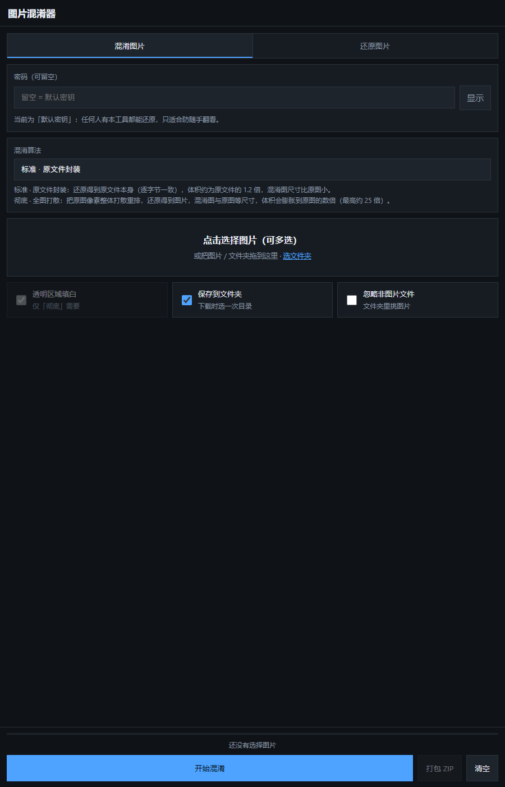

# Image Obfuscator · 图片混淆器

**Share a scrambled PNG instead of the picture you don't want to show.** Mix one image or a
whole folder into noise, send that, and restore the originals later with the same password.

[**Open it →**](https://yjc925925.github.io/image-obfuscator/) · works on desktop, Android, and
iOS · **one HTML file, no build, no install, no server, no network** — nothing you load ever
leaves the browser.



---

## Quick start

1. **Online:** <https://yjc925925.github.io/image-obfuscator/> — or download
   [`index.html`](index.html) / [`图片混淆器.html`](图片混淆器.html) and double-click it. Both
   files are byte-identical; pick whichever name you prefer.
2. Choose **混淆图片** (Mix) or **还原图片** (Restore).
3. Type a password (may be empty), pick an algorithm (default **标准**).
4. Drop in images, or pick files, or pick a whole folder.
5. Press **开始混淆 / 开始还原**.
6. Download one by one, or hit **打包 ZIP** to take them all at once (one save dialog instead of
   many — recommended on phones).

Restore auto-detects which algorithm produced a file, so there is nothing to choose. A file
named `photo.jpg` comes back as `photo.mix.png`; restoring strips the `.mix` and returns
`photo.png` (the restored image is always a PNG even when the source was a JPEG).

## The two algorithms

| | 标准 · 原文件封装<br>Standard · file envelope | 彻底 · 全图打散<br>Thorough · full scramble |
|---|---|---|
| What you share | a noise PNG containing the **whole original file** | a noise PNG the **same size as the original** |
| What comes back | the original file, **byte-for-byte** — format, EXIF, extension and all | the original pixels, pixel-for-pixel (EXIF and original encoding are gone) |
| Canvas | sized to the payload, **smaller than the original** | original size plus 16 pixels of header room |
| Volume | ≈ 1.2× the original file | ≈ 3.5 MB per megapixel (a 10 MB JPEG can become ~250 MB) |
| Ceiling | one file of any size the canvas can hold | 48 MP per image |
| Best for | photos, screenshots, documents-as-images, anything you want back exactly | pictures you genuinely don't want recognised |

Both are **lossless and reversible**, and both produce a PNG that **must not be touched**: turn
it into a JPEG, crop it, screenshot it, or re-save it from a photo app and the payload is gone
forever. When sending, use *file* mode rather than *image* mode (WeChat: `+` → 文件; QQ: 发送文件),
or send a ZIP.

### Measured sizes

The envelope's canvas is sized to its payload, so the ratio depends on the embedded file, not on
the picture's dimensions. Measured with `src/codec2.js`, assuming a typical JPEG at ~8% of raw RGB:

| Original | File ≈ | Envelope canvas | Per side |
|---|---|---|---|
| 1280×720 | 0.22 MB | 362×204 | 0.283× |
| 1920×1080 | 0.50 MB | 570×321 | 0.297× |
| 4000×3000 | 2.88 MB | 1131×849 | 0.283× |

A heavy file in a small picture scales the other way: a 20 MB file inside a 1920×1080 image
needs a 3615×2033 canvas (1.88× per side). Thorough mode is simply the original plus
`ceil(16 / height)` columns — 1.0008× per side at 1280×720.

> **Correction.** The English notes shipped with v1.0.0 and v1.0.1 claimed standard mode scaled
> the picture **up** by ~1.22× per side and that thorough mode grew volume by "up to 1.7×". Both
> were inferred rather than measured, and both are wrong; the numbers above come from running the
> codec. See the [changelog](CHANGELOG.md).

## Must-know

- The output is a PNG of random pixels: **one altered pixel and it can never be restored.**
  Converting, cropping, compressing, screenshotting, or letting a photo app re-save it all
  destroy the payload.
- The password is stored nowhere. Forget it and the picture is gone. An empty password uses a
  built-in key: the image still becomes noise, but anyone holding this tool can restore it — use
  it only against casual glances. For anything real, use 8+ characters.
- On Windows, a file downloaded from a local page may trigger "your Internet security settings
  prevented one or more files from opening". That is Windows tagging the file as coming from a
  restricted zone, not corruption. Files written via **保存到文件夹** avoid the tag; for existing
  files, right-click → Properties → Unblock, or run
  `Get-ChildItem -Recurse -File | Unblock-File`.
- **透明区域填白** only matters for thorough mode, which discards the alpha channel. Standard mode
  preserves the original file untouched, transparency included.

## Opening it on each platform

- **Windows / macOS:** double-click the HTML file; Chrome or Edge.
- **Android:** save the file, then open it with a browser from the file manager.
- **iPhone / iPad:** iOS has no direct "open a local web page" entry point. Upload the file to any
  static host (or drag it to `app.netlify.com/drop`), open that URL in Safari, then *Add to Home
  Screen*. The page itself still needs no network. Downloads land in the Files app.

## How it works

Both algorithms share one key schedule: `key = SHA-256(password ‖ 8-byte nonce)`, iterated 4096
times, with separate domain tags so the permutation stream and the data stream never interfere.

**Standard (envelope), algorithm version 2.** The logical byte stream is 8 random bytes, one
marker byte, then the encrypted region: a 64-byte header (magic, version, flags, filename length,
original width/height, payload length, the payload's `SHA-256`, and an 8-byte authentication tag
derived from the key), followed by the filename and the raw original bytes. The whole region is
XORed with one keystream. The canvas is sized to hold it while keeping the original aspect ratio,
never smaller than 8×8.

**Thorough (full scramble), algorithm version 1.** The output is the original plus 16 pixels of
header room holding the nonce and a 32-byte header. Three reversible transforms: a per-pixel
Fisher–Yates permutation driven by a key-derived random stream, a second independent stream XORed
over the whole image, and a forced fully-opaque output (which sidesteps canvas premultiplied-alpha
rounding). Restoring inverts them in order; altering one header byte is detected by the checksum.

**This is obfuscation, not encryption.** 4096 rounds of SHA-256 is not a memory-hard KDF, and
anyone holding the PNG can attack it offline. Treat the password as a speed bump, not a vault.

## Limits

- 48,000,000 pixels per image; 32,000 px per side.
- ZIP export refuses to build above 900 MiB (single-file download instead).
- Processing is serial and in-browser; the start button doubles as a stop button.

## Repository layout

```
index.html           the built app (also what GitHub Pages serves)
图片混淆器.html        the same bytes under a Chinese name
src/                 source
  crypto.js          SHA-256 and the keystream PRNG
  codec.js           thorough algorithm: pixel-level scramble
  codec2.js          standard algorithm: original-file envelope
  zip.js             ZIP writer (stored, not deflated)
  app.js             UI and batch pipeline
  index.html         the page shell
  selftest.js        in-page self-check (development only, not bundled)
test/                test suites
  core.mjs           thorough-codec assertions (Node, 83 checks)
  core2.mjs          standard-codec assertions (Node, 177 checks)
  browser.mjs        in-browser self-check via CDP (22 checks)
  ui.mjs             real end-to-end UI run (75 checks)
build.mjs            inlines src/ into the single-file app
```

## Development

```bash
node build.mjs            # writes index.html and 图片混淆器.html
node test/core.mjs        # 83 checks
node test/core2.mjs       # 177 checks
```

The browser suites need a Chrome started with a debug port:

```bash
chrome --headless=new --remote-debugging-port=9336
node test/browser.mjs index.html
node test/ui.mjs index.html
```

`build.mjs` fails loudly if the bundling assumptions break — it insists on exactly five inlined
scripts and no remaining external `src`/`href` references, which is what keeps the output a
genuinely self-contained file.

## License

[MIT](LICENSE) — Copyright (c) 2026 DeepSeek.

---

# 中文说明

**在线打开**（电脑 / 安卓 / iOS 都可以，不用下载）：
<https://yjc925925.github.io/image-obfuscator/>

单文件离线网页工具：把图片批量混淆成无法辨认的噪声图，也能批量还原回来。支持电脑、安卓、
iOS，双击 HTML 用浏览器打开即可，全程不联网、不上传任何数据。

## 用法

1. 用浏览器打开 `index.html` 或 `图片混淆器.html`（两份内容完全相同）
2. 选「混淆图片」或「还原图片」
3. 填密码（可留空）
4. 选一种算法（默认「标准」，两种算法的区别见下）
5. 点选择框选图片、把图片或文件夹拖进页面、或点「选文件夹」
6. 点最下面的「开始混淆 / 开始还原」
7. 结果可以一张一张下载，也可以「打包 ZIP」一次拿走（手机上建议用 ZIP，只弹一次保存框）
8. 每一行右边有「预览」「下载」「删除」：预览直接看结果（点空白处或按 Esc 关闭），下载拿走
   单张，删除单独去掉某一张（正在处理时暂时不可用）
9. 点「下载」或「打包 ZIP」时，会先让你选**一次**文件夹（勾着「保存到文件夹」时），结果直接
   写进那个文件夹，之后不再逐张弹窗

还原时会自动识别用的是哪种算法，不用再选。`photo.jpg` 混淆后叫 `photo.mix.png`；还原时去掉
`.mix`，还原出来的文件是 `photo.png`——还原结果一律是 PNG，即使原图是 JPEG。

## 两种算法

**标准 · 原文件封装（默认）**

- 把原始文件本身（JPEG / PNG 的字节）加密后封进一张噪声图，还原出来的是**原文件本身，逐字节
  一致** —— 格式、EXIF、后缀全都回来。
- 混淆图的画布按载荷大小开，**尺寸比原图小**；体积约为原文件的 1.2 倍（10 MB 的照片，混淆后
  12 MB 左右）。实测：1920×1080 的图装 0.5 MB 文件，画布 570×321；装 20 MB 文件则要
  3615×2033。

**彻底 · 全图打散**

- 把原图像素整体打散重排，还原得到图片，画面与原图逐像素一致，但 EXIF、原始文件体积之类的
  信息会丢掉。
- 混淆图与原图等尺寸（只多 16 像素的头部空间）、纯噪声，体积按像素算：约每 100 万像素
  3.5 MB，最高能到原图的 25 倍。

两种算法的结果都是 PNG 噪声图，都不能被压缩、截图或重新保存。

## 必须注意

- 混淆结果是 PNG 噪声图，**一个像素都不能动**。以下操作会让它永久无法还原：
  转成 JPG、截图、裁剪、重新压缩、用修图 App 打开后保存、用微信或 QQ 的「图片」方式发送。
- 发送时请用「文件」方式（微信：`+` → 文件；QQ：发送文件），或者先打包成 ZIP 再发。
- 密码不保存在任何地方，忘了就真的还原不出来。留空表示使用内置默认密钥：图片照样变成噪声，
  但任何拿到本工具的人都能一键还原，只适合防随手翻看。
- 要正经保密就设一个 8 位以上的密码，并且混淆和还原用同一个密码。
- Windows 上双击结果提示「你的 Internet 安全设置阻止打开一个或多个文件」：那是浏览器给
  **从本地网页下载**的文件打的「受限站点」标记，不是文件坏了。用「保存到文件夹」保存的结果
  没有这个标记；已经中招的文件，右键 → 属性 → 勾「解除锁定」，或者对文件夹跑一次
  `Get-ChildItem -Recurse -File | Unblock-File`。
- 「透明区域填白」只在「彻底」算法下有用（它会抹掉透明通道）。「标准」算法保留原始文件，
  透明区域照原样保留。

## 三端打开方式

- **Windows / macOS**：双击 HTML 文件，用 Chrome 或 Edge 打开。
- **安卓**：把 HTML 存到手机，用文件管理器选「用浏览器打开」，或在 Chrome 地址栏输入
  `file:///sdcard/...`。
- **iPhone / iPad**：系统没有直接打开本地网页的入口。最省事的做法是把 HTML 拖到
  `app.netlify.com/drop`（或任意静态托管）拿到一个网址，用 Safari 打开后「添加到主屏幕」。
  页面本身不联网也能用。
- iOS 上「添加到主屏幕」后，处理结果会走 Safari 的下载，文件在「文件」App 里。

## 算法

**标准**

- 逻辑字节流 = 8 字节随机数（明文）+ 1 字节标记 + 加密区。
- 加密区开头是 64 字节头部：魔术字、版本、标志、文件名长度、原始宽高、载荷长度、载荷的
  SHA-256、以及由密钥派生的 8 字节校验标签；后面跟着文件名和原始文件字节。整段用一个密钥流
  异或。
- 画布按载荷大小开，保持原图宽高比，两边都不小于 8 像素。

**彻底**

- 输出图比原图多 16 个像素，用来放 8 字节随机数 + 32 字节文件头（含原始宽高和校验标签）。
- 三重可逆变换：① 全图逐像素 Fisher-Yates 置换（随机流由密钥派生）② 另一路独立随机流对整幅
  图异或 ③ 输出图强制完全不透明，规避 canvas 预乘精度的有损问题。还原就是逆序反演。
- 混淆图是纯噪声、尺寸只多 16 像素；头部被改一个字节都会被校验发现。

两种算法共用同一套密钥派生：密钥 = SHA-256 迭代 4096 轮（密码 + 随机数），置换流与数据流用
不同域标签，互不干扰。

## 限制

- 单张上限 4800 万像素、单边不超过 32000 像素。
- 批量打包 ZIP 上限约 900 MB，超了请单张下载。
- 处理在浏览器里逐张串行进行，中途可以点「开始」按钮停下。

## 目录与开发

```
index.html          成品（GitHub Pages 的入口，也是下载到的那份）
图片混淆器.html       同一份字节，中文名
src/                源码
  crypto.js         SHA-256 与伪随机流
  codec.js          彻底算法：像素级打散
  codec2.js         标准算法：原文件封装
  zip.js            打包 ZIP（仅存储，不压缩）
  app.js            界面与批处理逻辑
  index.html        界面
  selftest.js       自检用例（只在开发时用，不打包进成品）
test/               测试
  core.mjs          彻底算法核心断言（Node，83 项）
  core2.mjs         标准算法核心断言（Node，177 项）
  browser.mjs       浏览器端自检（经 CDP 注入 selftest.js，22 项）
  ui.mjs            真实界面端到端（75 项）
build.mjs           把 src 内联成单文件成品
```

重新构建：`node build.mjs`（产物直接落在仓库根目录）。跑测试：`node test/core.mjs`、
`node test/core2.mjs`；浏览器测试需要先起一个带调试端口的 Chrome
（`--headless=new --remote-debugging-port=9336`），再运行 `node test/browser.mjs index.html`
与 `node test/ui.mjs index.html`。
